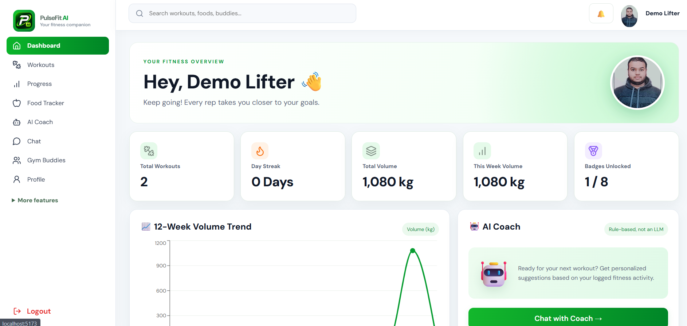
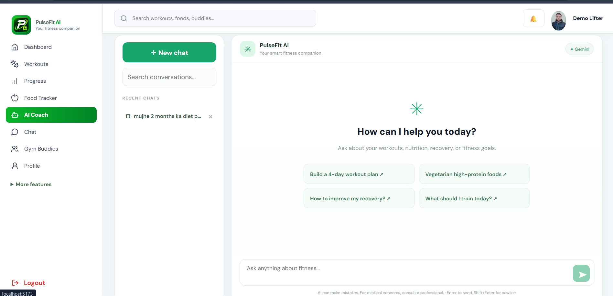
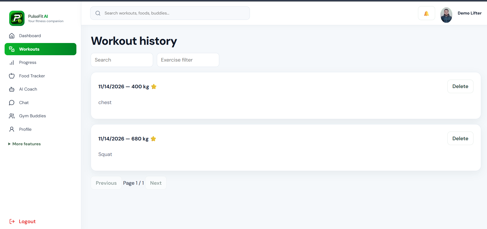
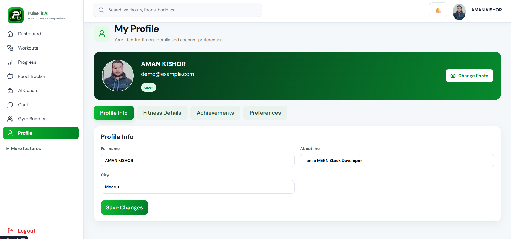

<div align="center">

# 💚 PulseFit AI

### Your smart fitness companion

**A full-stack fitness platform for tracking workouts, monitoring progress, managing nutrition, and getting AI-powered fitness guidance.**

[](https://react.dev/)
[](https://nodejs.org/)
[](https://www.mongodb.com/)
[](https://ai.google.dev/)

**Built by [Aman Kishor](https://github.com/iamankishor)**

</div>

---

## 📸 Project Preview

### Fitness Dashboard

Personalized overview with workout statistics, total training volume, streaks, achievement badges, and a 12-week volume chart.



### Gemini AI Fitness Coach

Fitness-focused conversational assistant with suggested prompts, searchable conversation history, and new-chat functionality.



### Workout History

Browse recorded workouts, search or filter exercises, and review training volume.



### Profile Management

Manage profile information, fitness details, achievements, preferences, and profile photos.



---

## ✨ Features

- **Fitness dashboard:** Workout summaries, streaks, volume analytics, and achievement tracking.
- **Workout tracker:** Record exercises and review workout history.
- **AI fitness coach:** Google Gemini-powered conversations about training, nutrition, and recovery, with saved chat history.
- **Progress analytics:** Charts and training progress insights.
- **Food tracker:** Log meals and track nutrition.
- **Gym buddies and chat:** Social fitness features and messaging.
- **User profiles:** Edit personal information, fitness details, and profile photo.
- **Additional tools:** The project also includes optional fitness features accessible from the sidebar.

> PulseFit AI is a portfolio/demo project. Fitness and nutrition information is educational and not a substitute for professional medical advice.

## 🧰 Tech Stack

| Layer | Technologies |
| --- | --- |
| Frontend | React 18, Vite, React Router, CSS, Lucide React |
| Charts | Recharts |
| Backend | Node.js, Express.js |
| Database | MongoDB, Mongoose |
| Authentication | JWT, bcryptjs |
| AI integration | Google Gemini API (`@google/genai`) |
| Realtime | Socket.IO |
| API requests | Axios |
| Optional Python service | FastAPI skeleton (not implemented for production AI inference) |

## 📁 Project Structure

```text
pulsefit-ai/
├── frontend/          # React + Vite client
├── backend/           # Express API, MongoDB models, routes
├── ai-engine/         # Optional Python/FastAPI skeleton
├── screenshots/       # README preview images
└── README.md
```

## 🚀 Run Locally

### Prerequisites

- Node.js 18 or newer
- MongoDB (local or Atlas)
- Google Gemini API key for AI Coach

### 1. Clone the repository

```bash
git clone https://github.com/iamankishor/PulseFit-AI.git
cd PulseFit-AI
```

> If your repository contains a nested `pulsefit-ai` directory, run `cd pulsefit-ai` before the next steps.

### 2. Set up the backend

```bash
cd backend
npm install
```

Copy `.env.example` to `.env` (Windows PowerShell):

```powershell
Copy-Item .env.example .env
```

Configure your own environment variables in `backend/.env`:

```dotenv
MONGO_URI=mongodb://127.0.0.1:27017/pulsefit
JWT_SECRET=replace-with-your-own-long-random-secret
GEMINI_API_KEY=your-own-gemini-api-key
GEMINI_MODEL=gemini-2.5-flash
PORT=5000
CLIENT_URL=http://localhost:5173
```

`GEMINI_MODEL` is configurable; use a model supported by your API key. **Never commit `.env` or real secrets.**

Start the backend:

```bash
npm run dev
```

Optional: `npm run seed` populates demonstration data, but **it deletes existing collections**. Use it only with a disposable development database.

### 3. Set up the frontend

Open a second terminal in the project directory:

```bash
cd frontend
npm install
npm run dev
```

If the frontend needs an API URL override, create `frontend/.env` with:

```dotenv
VITE_API_URL=http://localhost:5000/api
```

Open **http://localhost:5173** in your browser.

## 🔒 Security Notes

- Keep API keys, database credentials, and JWT secrets in local environment files only.
- Do not commit uploaded user images or other private user data.
- Demo credentials and seeded accounts are intended for local development only.
- Before public deployment, add appropriate production security, persistent media storage, and validation.

## 👨‍💻 Developer

**Aman Kishor** — MERN Stack Developer  
GitHub: [@iamankishor](https://github.com/iamankishor)

---

<div align="center">Made with 💚 for learning, building, and improving fitness experiences.</div>
